# مِراس على iPhone Duo: جودة الامتداد الكامل والتكيّف (13 نوفمبر 2026)

نطاق هذه الجولة طبقة العرض وحدها، في ثلاثة ملفات CSS: [miras-duo-layouts.css](../src/design/miras-duo-layouts.css) و[miras-calm.css](../src/design/miras-calm.css) و[miras-teacher-home-plus.css](../src/design/miras-teacher-home-plus.css). لم يتغير شيء في `App.tsx` ولا الخادم ولا المصادقة ولا قواعد Firestore ولا الدرجات ولا بيانات الطلبة ولا ملفات النشر ولا غلاف iOS.

رموز الحالة: `PASS` تحقق مشاهَد أو مختبَر، و`PARTIAL` جزئي، و`FAIL` خلل باقٍ، و`BLOCKED` يحتاج جهازًا أو قرارًا من المالك، و`NOT_APPLICABLE` غير ذي صلة، و`NOT_TESTED` لم يُختبر.

ملاحظة على المرجع: الملف الرئيسي `~/Desktop/00_MASTER_CLAUDE_CODE_AR.txt` لم يكن موجودًا على القرص وقت العمل. اتبعت تعريفات الوضعيات A–J المستعملة في جولة Orbit من اليوم نفسه، ومعها `~/duo-work/DUO_BRIEF.md` و`RUN_2026-11-13.md`.

## 1. ما كان على main قبل الجولة

جولات سابقة بنت طبقة Duo فعلًا ([#280](https://github.com/ProfAlfailakawi/Mirasedu/pull/280) ثم تلميعات #282 إلى #291). كان موجودًا: إلغاء قفل الاتجاه، و`touch-action: manipulation` بدل منع التكبير، والحقول بخط 16px على اللمس، و`100dvh`، والتحول إلى عمودين من 600px، والـrail الجانبي للمعلم في الارتفاع القصير بين 520 و920px. لم أُعِد بناء شيء من ذلك. الإصلاحات أدناه تخص ما بقي مكسورًا تحته.

## 2. خط الأساس قبل التعديل (`origin/main` = `36dee17`)

| الفحص | النتيجة |
|---|---|
| `npm ci` | PASS |
| `npm run lint` (`tsc --noEmit`) | PASS |
| `npm run build` | PASS |
| `npm run test:flows` محليًا | FAIL بيئي: خادم الاختبار لم يقلع لأن `esbuild` (داخل `tsx`) انهار بتفريغ goroutines. الجهاز كان يشغّل نحو عشر جلسات بناء متزامنة. لا اختبار فشل فعلًا ("server cannot start; aborting remaining groups"). على GitHub نجح `PR Verification` (lint ثم flows ثم build) للـPR #294 الذي هو رأس main نفسه |
| مصفوفة WebKit قبل التعديل | لا تمرير أفقي في أي حالة. ظهرت العيوب المذكورة في القسم 3 |

## 3. ما وُجد وما أُصلح من جذوره

| # | العَرَض (قبل) | الجذر | الإصلاح |
|---|---|---|---|
| 1 | أزرار ترويسة المعلم (الرئيسية، الوضع الليلي، البصمة، التنبيهات، خروج) عرضها 40px على كل شاشة ≤920px: المطوي 382 والمطوي العرضي 600 والمفتوح الطولي 669 والـSplit بأنواعه والآيفون | قاعدة "صف واحد" في `miras-teacher-home-plus.css` بستة محددات `:not(#…)` تفرض `width: 2.5rem; min-width: 0 !important`، فتغلب قاعدة الـ44px الموجودة في `miras-duo-layouts.css` (أربعة محددات فقط) | القاعدة نفسها صارت `width: 2.75rem` (44px) مع إمكان الانكماش حتى 32px حين لا يتسع الصف فقط. عمود الأزرار في شبكة الترويسة ([index.css](../index.css)) صار `minmax(0, max-content)` بدل `auto`، والصف `max-width: 100%`، فلا يُدفع زر الخروج خارج الترويسة المقصوصة. بخمسة أزرار (الحالة المعتادة) تبقى 44px في كل المقاسات من 320 إلى 920 |
| 2 | الأزرار نفسها على الشاشة الواسعة (Duo مفتوح عرضيًا 951، وiPad) عرضها 41.6px | `miras-calm.css` تضعها `2.6rem` من 921px، وهذا العرض يصل إليه الـDuo المفتوح وهو جهاز لمس | `2.75rem` |
| 3 | زر "عرض حالة الاتصال" (اسم الحساب) ارتفاعه 40px للمعلم والطالب | قاعدتان في `miras-calm.css` تفرضان `min-height: 2.5rem !important` فوق قاعدة 44px | `2.75rem` في القاعدتين |
| 4 | زر "إغلاق الرسالة" في رسالتي النجاح والخطأ 40×40، وزرا "لاحقاً" و"تثبيت الآن" في شريط تثبيت التطبيق 40px | أصناف Tailwind `h-10 w-10` في `App.tsx` | قاعدة لمس (`pointer: coarse`) في `miras-duo-layouts.css` القسم 6-أ: حد أدنى 44px. لم يُمَسّ `App.tsx` |
| 5 | المعلم على 951×350 (Duo مفتوح عرضيًا مع لوحة مثبتة) و`min-width: 921` مع ارتفاع ≤480: الترويسة اللاصقة بصفيها (الأدوات ثم التبويبات) تبقى 135px من 350، أي 39% من الشاشة طوال التمرير | قاعدة الارتفاع القصير الموجودة (الـrail) مقصورة على ≤920px. فوق ذلك تبقى ترويسة سطح المكتب اللاصقة كما هي | القسم 6-ب: في `(min-width: 921px) and (max-height: 480px)` تتحرك الترويسة مع الصفحة وتتقارب صفوفها. بعد التمرير صار الجزء الظاهر من الترويسة 0px بعد أن كان 135px |
| 6 | وضع الكتاب (مفصل عمودي عند x≈334): بطاقتا "الطلبة المفعّلون" و"المشاريع" في شبكة لوحة المعلم تعبران خط الطي | لا يوجد أي تعامل مع Viewport Segments | القسم 6-ج: `@media (horizontal-viewport-segments: 2)` يجعل شبكات العمودين في لوحة المعلم بعمودين متساويين وفاصل بعرض المفصل (`env(viewport-segment-*)`). دون الـAPI لا يُطبَّق |

## 4. فحص الامتداد الكامل

| البند | الحالة | الدليل |
|---|---|---|
| تمرير أفقي | PASS | 0 في كل الحالات: 12 مقاسًا × 9 شاشات (WebKit) قبل وبعد، وفي محاكاة المفصل |
| عناصر خارج الشاشة | PASS | 0 في كل الحالات |
| `viewport-fit=cover` والتكبير | PASS | `width=device-width, initial-scale=1.0, viewport-fit=cover` دون `user-scalable=no` |
| حواف الأمان | PASS (مراجعة كود) | الأشرطة الثابتة والـrail تستعمل `env(safe-area-inset-*)` من جولات سابقة. في Playwright قيمها صفر، فلم تُقَس على جهاز |
| ارتفاع الشاشة | PASS | `100dvh` على الجذر وغلاف المعلم (سابق) |
| `theme-color` | NOT_APPLICABLE | الموقع فاتح فقط (`color-scheme: light`, `#FFFFFF`). لم يتغير |
| لوحة المفاتيح | NOT_TESTED | المحاكي لا يُظهر لوحة مفاتيح حقيقية |

## 5. مصفوفة الوضعيات A–J

المنصة: Playwright WebKit (build 2370) بملف Safari المحمول للـDuo (UA الخاص به، لمس، `pointer: coarse`، DPR 2، تقليل الحركة)، والخادم محلي معزول (لا `firebase-applet-config.json`، `MIRAS_ALLOW_LOCAL_ONLY_MODE`) في البيئة التجريبية. الشاشات: الدخول، ولوحة المعلم (الرئيسية، المقررات، الطلبة، التسليمات، الأكواد)، والطالب (الرئيسية، الاختبارات، اختبار جارٍ).

| الوضعية | المقاس | المعلم | الطالب | الاختبار | الحالة |
|---|---|---|---|---|---|
| A مطوي طولي | 382×580 | أهداف اللمس 44px (كانت 40) | ✓ | ✓ يبدأ ويعرض الأسئلة | PASS (محاكاة) |
| B مطوي عرضي | 600×350 | rail جانبي (سابق)، الأزرار 44px | ✓ | ✓ | PASS (محاكاة) |
| C مفتوح طولي | 669×880 | شبكة 3×2، الأزرار 44px | ✓ | ✓ | PASS (محاكاة) |
| D مفتوح عرضي | 951×600 | ✓ الأزرار 44px (كانت 41.6) | ✓ | الاختبار العادي يرفض البدء بالعرض: "يرجى تدوير الجهاز للوضع الطولي". هذه قاعدة نزاهة مقصودة ولم تُغيَّر | PASS للتخطيط، BLOCKED للاختبار بالعرض (قرار المالك) |
| D قصير | 951×350 | الترويسة تتحرك مع الصفحة (كانت تأخذ 39%) | ✓ | — | PASS (محاكاة) |
| E كتاب | 669×880 + مفصل x=328، 12px | العناصر العابرة للمفصل 6 → 4. بطاقات الأرقام لم تعد تعبره. الباقي عناصر بعرض كامل (مبدّل المقرر، صف طلب كلمة المرور) | 3 → 3 (شريط الاختبارات/المشاريع) | — | PARTIAL في **محاكاة Chromium** (`Emulation.setDeviceMetricsOverride.displayFeature`). في Safari 27.1 الـAPI خلف علم: BLOCKED على الجهاز |
| F طاولة | 951×600 + مفصل y=294 | بطاقتا أرقام تعبران المفصل قبل وبعد | 0 | — | PARTIAL: الصفحة قابلة للتمرير، فلا يمكن تثبيت شيء عن المفصل دون تغيير طريقة التصفح |
| G نافذتان | 385×571 | ✓ | ✓ | ✓ | PASS (محاكاة) |
| H Split | 320 / 470 / 620 ×600، و669×520 (لوحة مثبتة) | ✓ في الأربعة | ✓ | ✓ | PASS (محاكاة) |
| I خيمة/حامل | — | — | — | — | NOT_TESTED: لا runtime يعلن هذه الوضعية |
| J انتقال حي | 951×600 ← 669×880 ← 470×600 ← 382×580 ← 600×350 ← 951×350 ← 951×600 دون إعادة تحميل | النص المكتوب في حقل الطلبة والتبويب المفتوح بقيا، و0 تمرير أفقي، و0 إعادة تحميل | — | اختبار جارٍ مع سؤال مجاب، ثم 669×880 ← 669×600 ← 669×880: بقي الاختبار مفتوحًا وبقيت الإجابة (19 سؤالًا متبقيًا قبل وبعد)، ولا رسالة مخالفة | PASS |

مقاسات إضافية: iPhone 390×844 و844×390 وسطح المكتب 1440×900. لا تمرير أفقي، والأزرار 44px.

### ما بقي في أهداف اللمس (PARTIAL)

- حين تظهر أزرار الترويسة السبعة كلها (معاينة العرض + الرادار + البصمة) على هاتف عرضه 320 إلى 390px، لا يتسع الصف لسبعة أزرار بـ44px. تنكمش الأزرار إلى 32–35px بدل أن يُقص زر الخروج (ملاحظة مراجعة Codex على الـPR). اختُبر بإضافة زرين مستنسخين إلى الصف: 0 أزرار مقصوصة في 320 و360 و382 و390 و470 و600 و669، والأزرار 44px من 470 فما فوق.

- حقل "أدخل الكود" في الأكواد وحقل البحث في التسليمات: الصندوق المرئي 46px، لكن عنصر `input` داخله ارتفاعه 24 إلى 26px. اللمس على حشوة الصندوق خارج الحقل قد لا يضع المؤشر فيه. إصلاحه يغيّر بنية الحقل في `App.tsx`، فتُرك.
- قائمة "تصفية الأسماء حسب التسجيل" في الطلبة: 130×24px. التعديل نفسه.

## 6. صور قبل/بعد

| الحالة | قبل | بعد |
|---|---|---|
| A مطوي 382×580، ترويسة المعلم | 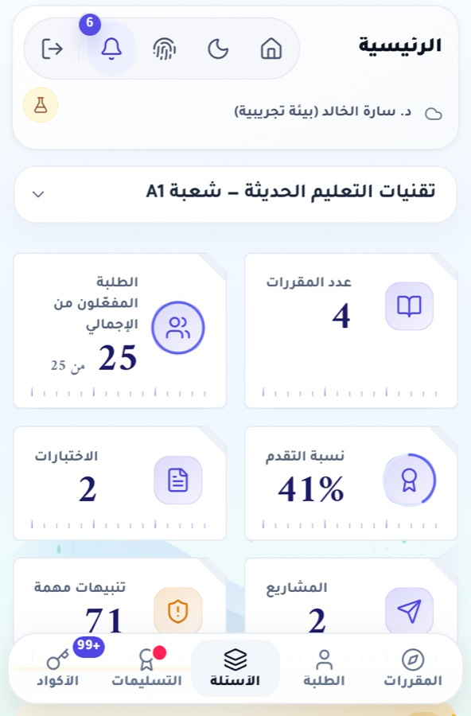 | 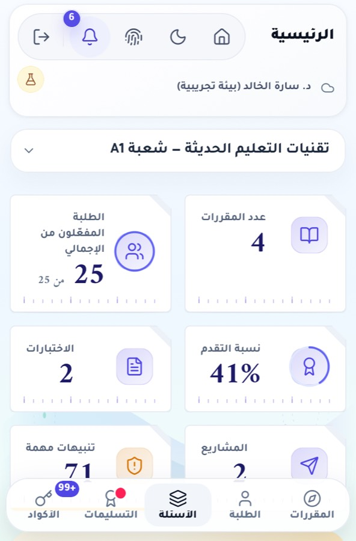 |
| 951×350 بعد التمرير 420px | 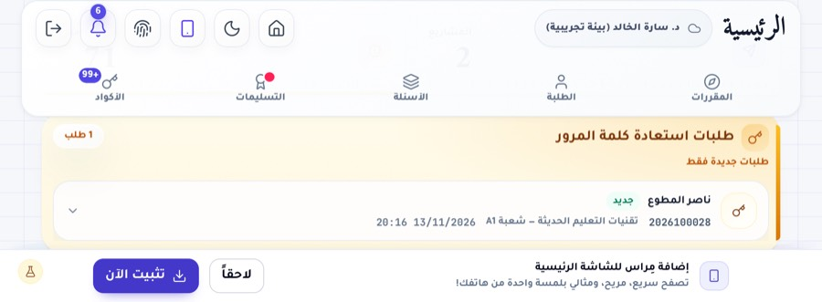 | 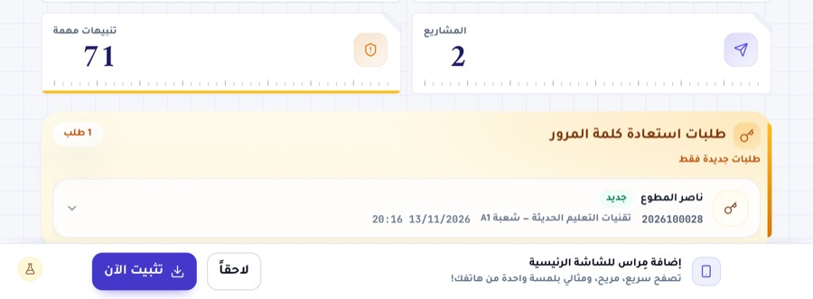 |
| E كتاب (محاكاة Chromium) | 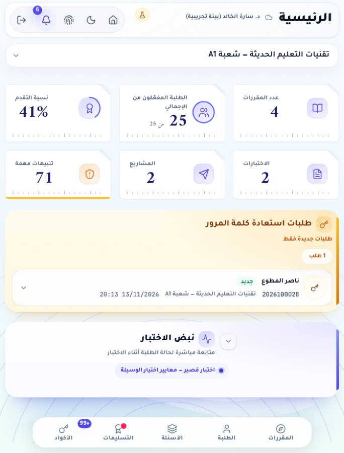 | 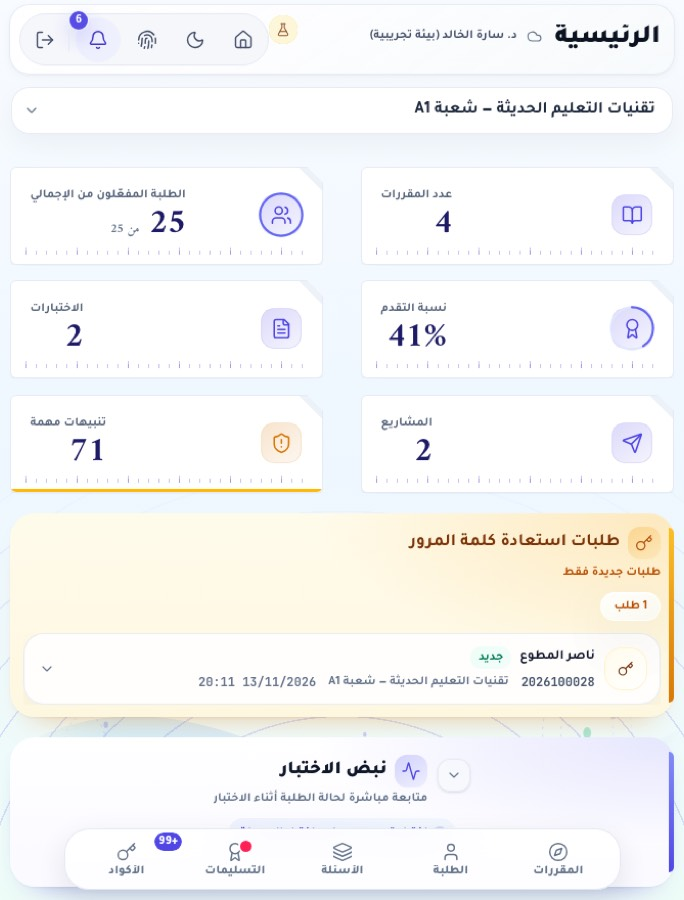 |

بعد التعديل فقط:

| الحالة | الصورة |
|---|---|
| A اختبار جارٍ 382×580 | 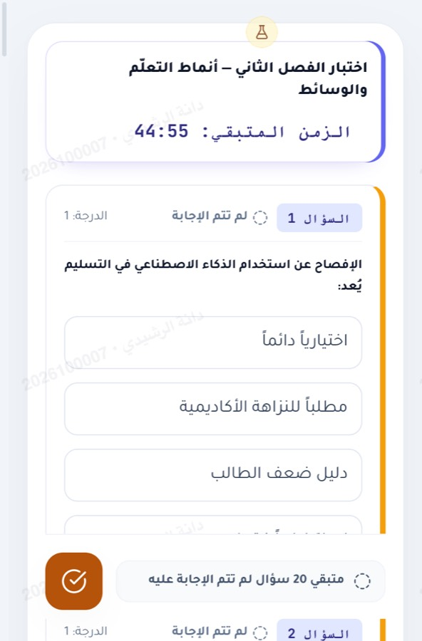 |
| B مطوي عرضي، المعلم | 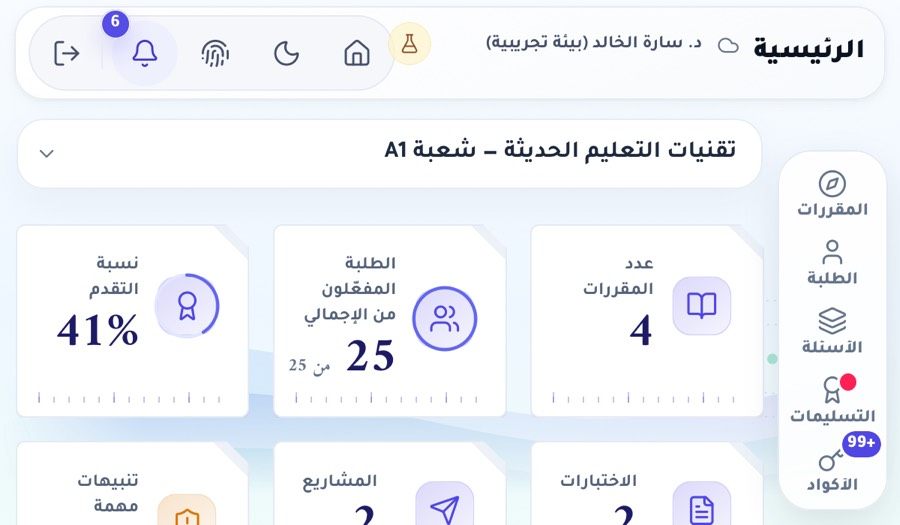 |
| B مطوي عرضي، اختبارات الطالب | 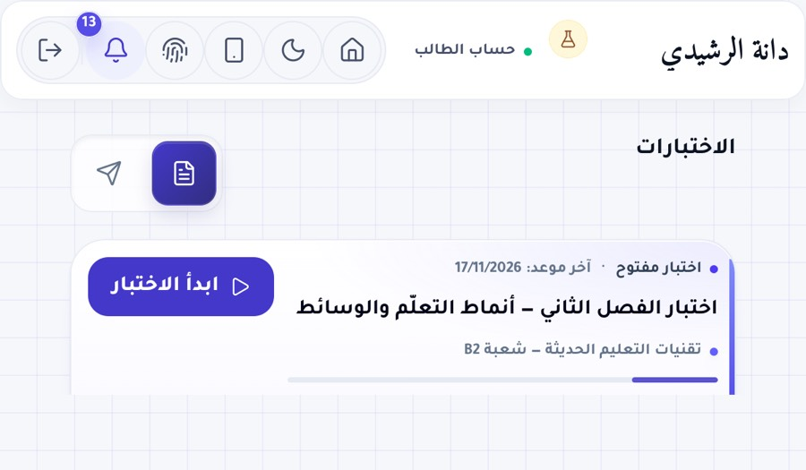 |
| C مفتوح طولي، المعلم | 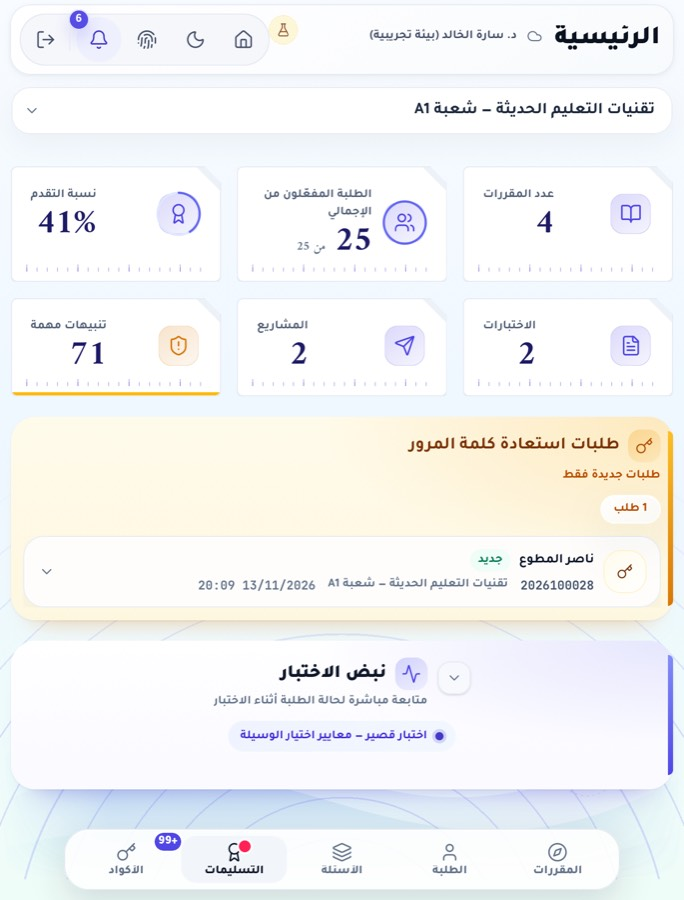 |
| C مفتوح طولي، اختبار جارٍ | 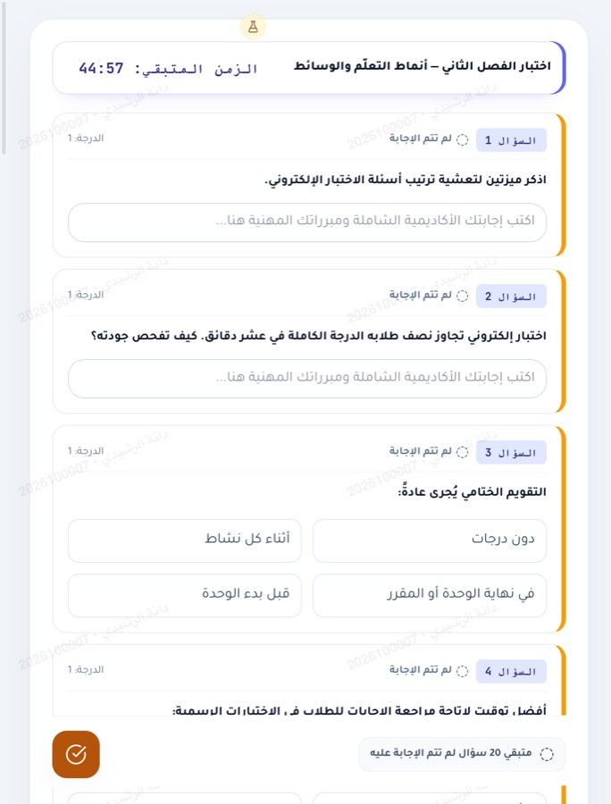 |
| D مفتوح عرضي، التسليمات | 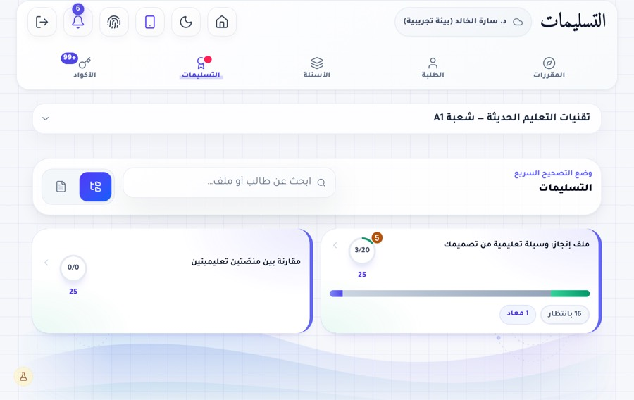 |
| D مفتوح عرضي، رفض الاختبار بالعرض (قاعدة نزاهة) | 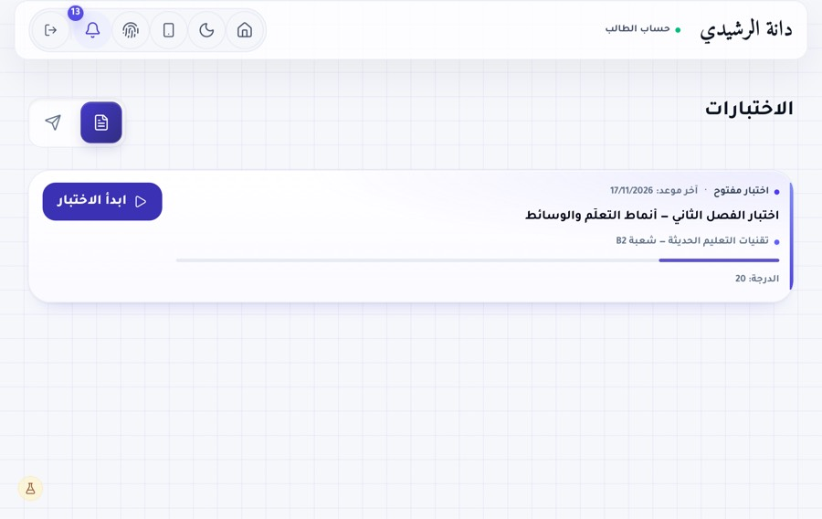 |
| F طاولة (محاكاة Chromium) | 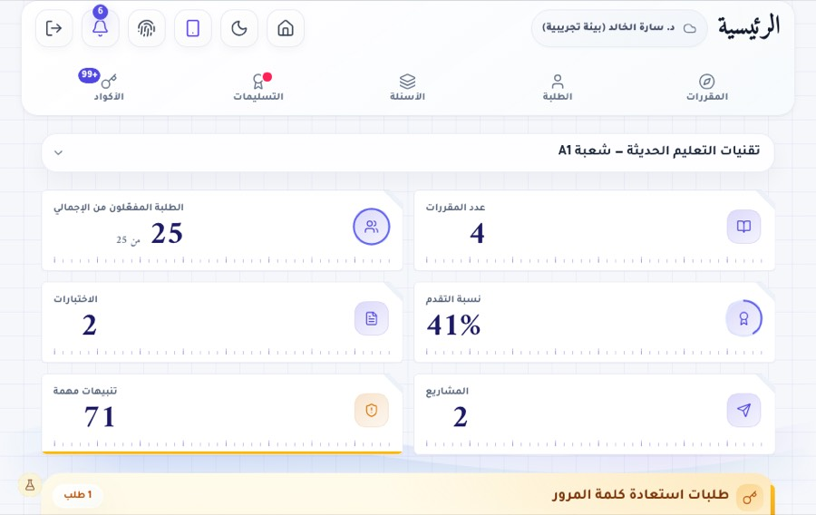 |
| H Split ضيق 320، الطلبة | 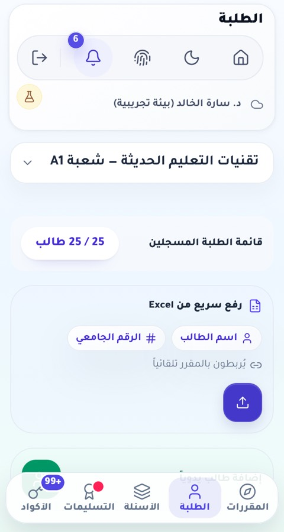 |
| H Split نصف 470، رئيسية الطالب | 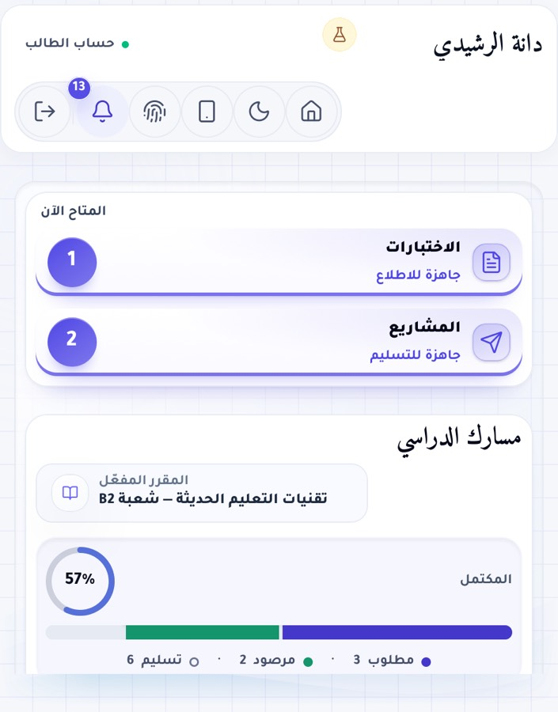 |
| J بعد الانتقال إلى 382×580 | 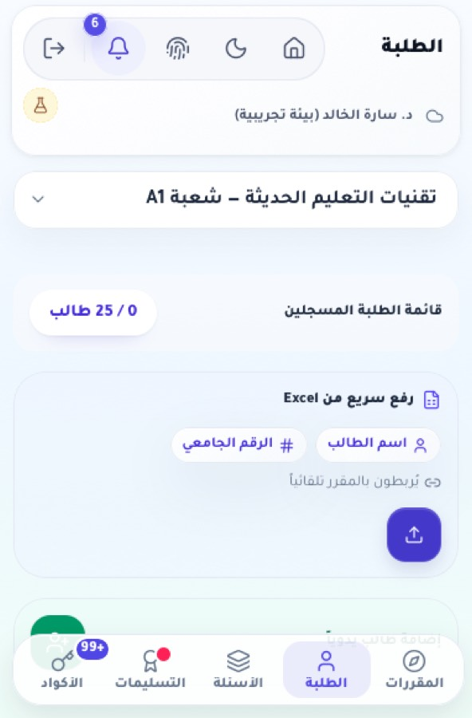 |
| J اختبار جارٍ بعد تقصير الارتفاع إلى 600 | 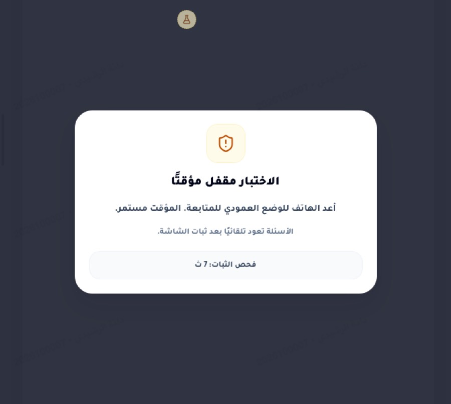 |

## 7. شروط نزاهة الاختبار على الـDuo (لم تُغيَّر)

بدء الاختبار العادي يمر بـ`getNormalExamViewportIssue` في `App.tsx`. هذا منطق نزاهة، فلم يُعدَّل، لكن أثره على الوضعيات:

| الحالة | الحساب في الكود | النتيجة المتوقعة |
|---|---|---|
| A مطوي في Safari (382 من شاشة 466، 580 من 678) | أصغر بُعد للشاشة < 700، فالحد 68% عرضًا و52% ارتفاعًا. التغطية 82% و86% | يُسمح بالبدء |
| C مفتوح طولي 669×~880 من 669×951 | التغطية 100% و~93% | يُسمح |
| D مفتوح عرضي 951×669 | `isLandscape` | يُرفض: "يرجى تدوير الجهاز للوضع الطولي". قرار نزاهة مقصود؛ السماح بالشاشة الداخلية عرضيًا قرار للمالك |
| H Split ضيق 320 من 951 | التغطية 34% < 68% | يُرفض (Split View أثناء الاختبار) |
| H Split نصف 470 من 951 | 49% < 68% | يُرفض |

لم يُتحقَّق من هذه الأرقام على جهاز: قيم `screen.width/height` التي يعلنها Safari على الـDuo المطوي تحتاج قياسًا. في المحاكاة بدأ الاختبار في A وC وG وH320/470/620 حين كانت `screen` مساوية للنافذة.

## 8. الوصول والاتجاه

- RTL والخطوط كما هي (`dir=rtl`، Tajawal). PASS.
- التكبير غير مقفول. PASS.
- أهداف اللمس: كل أزرار الترويسة وزر الحساب وأزرار الرسائل وشريط التثبيت 44px الآن على اللمس. بقي الحقلان والقائمة في القسم 5. PARTIAL.
- نص أصغر من 12px: 0 في كل الحالات. PASS.
- تقليل الحركة: الاختبار أُجري بـ`reducedMotion: reduce`، والقواعد الجديدة لا تضيف حركة. PASS.
- VoiceOver حقيقي: NOT_TESTED.

## 9. أخطاء JavaScript أثناء الفحص

ظهرت في بعض الحالات قبل وبعد رسائل من نوع `Fetch API cannot load /api/cloud-status … due to access control checks` و`/sw.js …`. هذه طلبات أُلغيت حين أعاد السكربت تحميل الصفحة أو غيّر مقاسها. لم تظهر أخطاء من كود التطبيق.

## 10. الاختبارات بعد التعديل

| الأمر | النتيجة |
|---|---|
| `npm run lint` محليًا | PASS |
| `npm run build` محليًا | PASS |
| `npm run test:flows` محليًا | FAIL بيئي: الخادم لم يقلع ("server cannot start"): المنفذ 3917 كان مشغولًا بجلسة أخرى، ثم على منفذ آخر توقف Vite لإعادة تحسين الاعتماديات تحت الحمل |
| GitHub `verify` (lint ثم flows ثم build) | PASS على الـPR |
| CodeQL وGitGuardian | PASS |

## 11. القيود وما يجب فحصه على جهاز حقيقي

1. Safari 27.1: `Viewport Segments` و`Device Posture` خلف علم، فكتلة الكتاب لن تعمل إلا بتفعيله. دونه يبقى التخطيط العادي المختبَر أعلاه.
2. محاكاة Playwright ليست جهازًا: حواف الأمان وعمود Safari الجانبي ولوحة المفاتيح لم تُقَس.
3. على محاكي أو جهاز Duo:
   1. المطوي 382×580: أزرار ترويسة المعلم الخمسة في صف واحد بقطر 44px؟
   2. افتح الشاشة الداخلية عرضيًا وثبّت لوحة تقصّر الارتفاع إلى نحو 350: هل تختفي ترويسة المعلم مع التمرير؟
   3. ابدأ اختبارًا تجريبيًا على الشاشة المطوية في Safari: هل يبدأ كما يتوقع الحساب في القسم 7؟ وسجّل `screen.width/height` هناك.
   4. فعّل علم Viewport Segments وافتح نصفيًا كالكتاب: هل يقع الفاصل بين عمودي بطاقات الأرقام على المفصل؟
4. تطبيق iOS في [apple/](../apple/) يحمّل الموقع، فيصله هذا التعديل بعد النشر. لم يُبنَ في هذه الجولة.

## 12. النشر

الدمج في `main` لا ينشر تلقائيًا. الواجهة تُنشر بـ`Deploy to Firebase Hosting` (`workflow_dispatch`)، والـAPI بـ`نشر مِراس API إلى Cloud Run` (`workflow_dispatch`). التعديل CSS فقط، فيكفي نشر الواجهة:

```bash
gh workflow run firebase-hosting-deploy.yml --ref main -R ProfAlfailakawi/Mirasedu
```
